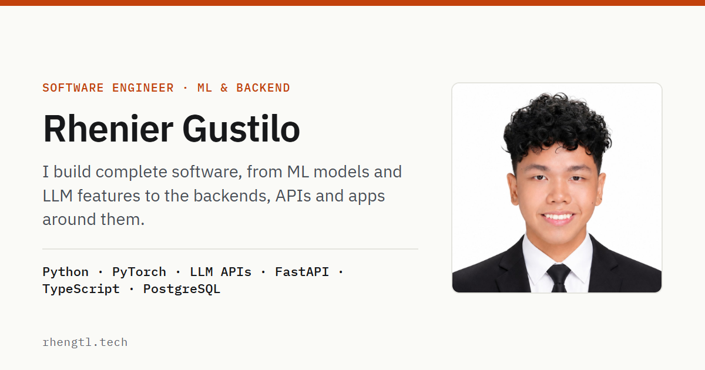

# rhengtl.tech

Source code for the portfolio of **Rhenier Gustilo**, a software engineer working across machine
learning and backend systems. The site presents six projects, with in-depth case studies for the
three largest, plus experience, skills and credentials.

**Live site:** <https://rhengtl.tech>



## Highlights

- **Static and fast.** Every page is pre-rendered HTML with no client framework; the site's own
  JavaScript is about 1 kB gzipped (theme toggle, mobile menu, active section, copy button).
  Lighthouse on mobile scores 99–100 for performance and 100 for accessibility, best practices
  and SEO.
- **Case studies as content.** Projects are MDX files in a typed content collection. Charts and
  diagrams (latency scale, before/after comparisons, pipeline flows) are plain HTML and CSS
  components, so their labels stay real text at any screen size.
- **Accessible.** Built to WCAG 2.2 AA: semantic landmarks, visible focus, a keyboard-operable
  menu, reduced-motion support, and light and dark themes that follow the system setting. Every
  page reports zero axe-core violations.
- **Secure by default.** A per-page Content-Security-Policy with hashed scripts and styles,
  security headers from `vercel.json`, and no third-party scripts. Analytics are cookieless.
- **Generated assets.** The social preview images are rendered from code (`scripts/og.mjs`), and
  the public résumé PDF is generated and checked by script (see below).

## Tech stack

| Area | Choice |
|---|---|
| Framework | [Astro 7](https://astro.build), static output |
| Language | TypeScript (strict) |
| Content | MDX with Zod-validated content collections |
| Styling | Scoped CSS with design tokens; IBM Plex Sans and Mono via the Astro Fonts API |
| Images | `astro:assets` (AVIF and WebP, responsive sizes) |
| Tooling | `astro check`, Prettier, Playwright (asset generation), axe-core (audits) |
| Hosting | Vercel, with Vercel Web Analytics |

## Getting started

Requires Node.js 22.12 or newer.

```sh
npm ci
npm run dev       # development server at http://localhost:4321
npm run build     # type-check, then build the static site into dist/
npm run preview   # serve the production build locally
```

## Project structure

```
src/
  components/         UI components; case/ holds the case-study figures and charts
  content/projects/   one Markdown or MDX file per project
  content.config.ts   project schema (the build fails on missing covers, alt text or metrics)
  data/site.ts        name, links, navigation, experience, skills and credentials
  layouts/            base page and case-study layouts
  pages/              home, /projects/[slug] and 404
  styles/             design tokens and global styles
public/               static files: icons, social images, media and the résumé PDF
scripts/              asset generation (social images, résumé)
```

## Editing content

| To change | Edit |
|---|---|
| Name, title, links, experience, skills, credentials | `src/data/site.ts` |
| A project or case study | `src/content/projects/<slug>.mdx` |
| Colours, spacing, type scale | `src/styles/tokens.css` |
| Site origin (canonical URLs, sitemap) | `SITE` in `astro.config.mjs` and `public/robots.txt` |

To add a project, create `src/content/projects/<slug>.md` (or `.mdx`) with the frontmatter defined
in `src/content.config.ts`. A file with a body becomes a case study at `/projects/<slug>`.

### Social preview images

`public/og/*.png` (1200 × 630) are generated from the site's own fonts and colours. After changing a
featured project's title, tagline, headline metric or cover image:

```sh
npm run build && node scripts/og.mjs
```

The script renders with Microsoft Edge through `playwright-core`.

### Résumé

`public/Rhenier-Gustilo-Resume.pdf` is generated by `scripts/resume.mjs` and validated by
`scripts/resume-check.mjs` (one US Letter page, embedded fonts, correct text order and working
links). The résumé's source content is kept out of this repository, so these two scripts won't run
from a fresh clone. The Résumé buttons appear on the site only when the PDF exists.

## Deployment

The site deploys to Vercel from the `main` branch as a static build. `vercel.json` configures clean
URLs, security headers and caching. The Content-Security-Policy is generated per page by Astro
(`security.csp` in `astro.config.mjs`). Web Analytics loads only in builds that run on Vercel.

## License

This repository has no open-source license. The code is public so it can be read as part of the
portfolio. The written content, photos, résumé and project media are © Rhenier Gustilo, all rights
reserved. If you'd like to reuse something, please get in touch.

## Contact

[rheniergustilo06@gmail.com](mailto:rheniergustilo06@gmail.com) ·
[LinkedIn](https://www.linkedin.com/in/rhengtl/) · [GitHub](https://github.com/RhenGTL)
